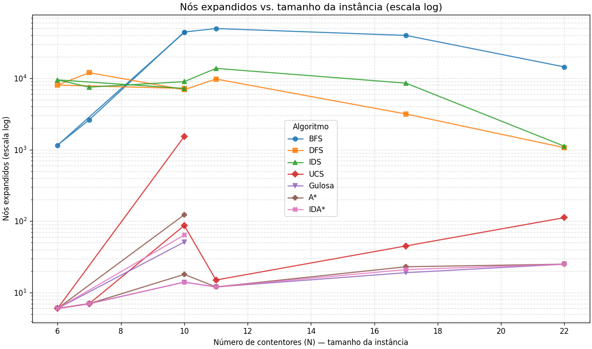
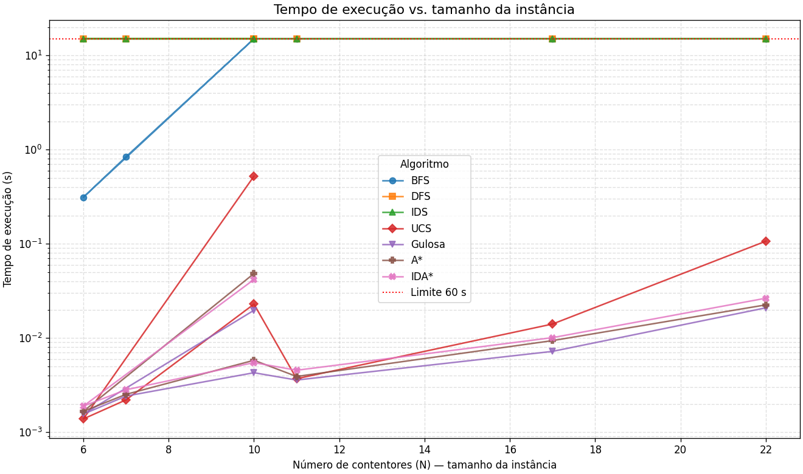
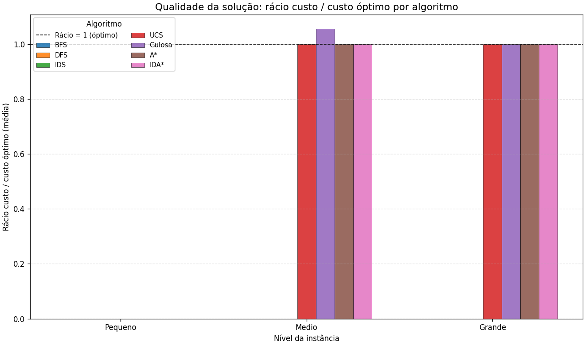

# Relatório da Frente 5 — Geração, Experiências e Interface

**Universidade Eduardo Mondlane — Faculdade de Engenharia**
**Inteligência Artificial I · 2026 · Grupo 02 (Laboral)**
**Responsável:** Manuel, Modesta Cipriano

---

## Capítulo 1 — Introdução e Contextualização do Porto de Maputo

O Porto de Maputo é o principal terminal portuário de Moçambique e um dos
corredores logísticos mais relevantes da África Austral. Localizado na baía de
Maputo, opera contentores de diversos tipos — standard, pesados e
refrigerados — que chegam por via marítima e são reordenados no pátio para
posterior levantamento por camiões, comboios ou navios de feeder. A gestão
manual destas operações gera atrasos, especialmente quando o pátio atinge
níveis elevados de ocupação e os gruas têm de efectuar movimentos
repetitivos para expor o contentor certo.

O problema P2 — Reordenação de Contentores — formaliza esta tarefa: dado um
conjunto de pilhas de contentores com altura máxima `H` e `S` pilhas, o
objectivo é levantar os contentores por ordem numérica (1, 2, …, N) movendo
apenas o topo de cada pilha e respeitando três restrições reais:

1. **Altura** — nenhuma pilha pode exceder `H` contentores;
2. **Peso** — um contentor *pesado* só pode descansar sobre uma pilha vazia
   ou sobre outro contentor pesado;
3. **Refrigeração** — contentores *refrigerados* só podem ser colocados em
   pilhas com tomada eléctrica (no modelo, as pilhas 0 e 1).

Este projecto implementa sete algoritmos de busca sobre o P2 — quatro não
informadas (BFS, DFS, IDS, UCS) e três informadas (Gulosa, A* e IDA*) — e
avalia-os numa bateria de 30 instâncias aleatórias geradas com a semente
oficial do Grupo 02 (202602). A Frente 5 entregou três componentes de
software: o **gerador** (`gerador.py`), a **bateria experimental**
(`experiencias.py`) e a **interface interactiva** (`main.py`), além de
testes automatizados e deste relatório.

**Objectivo geral.** Comparar o desempenho dos sete algoritmos em termos de
nós expandidos, tempo de execução, memória consumida e qualidade da solução
(rácio custo/custo óptimo), caracterizando até que ponto a informação
heurística reduz o esforço de procura em instâncias de tamanho crescente.

**Contexto institucional.** O projecto resulta da colaboração de cinco
frentes de trabalho (F1–F5) no âmbito da Unidade Curricular de Inteligência
Artificial I, sob orientação docente. A F5 tem como entregáveis específicos
a automatização da geração de instâncias, a execução experimental, os
gráficos/CSVs resultantes e a interface de utilização.

---

## Capítulo 5 — Implementação da Frente 5

### 5.4 — Gerador de instâncias (`gerador.py`)

#### 5.4.1 — Semente oficial e reprodutibilidade

O gerador usa a **semente oficial do Grupo 02: `202602`**, definida no
GUIA_INTEGRACAO_GRUPO02.md. Para cada nível (Pequeno, Médio, Grande) e índice
(0 a 9), deriva-se uma semente específica:

```text
semente_derivada = SEMENTE_OFICIAL + offset(nivel) + indice
```

com `offset = {Pequeno: 0, Medio: 1000, Grande: 2000}`. Esta fórmula garante
que duas execuções do gerador produzem exactamente os mesmos 30 ficheiros
JSON, em qualquer máquina com Python 3.10+.

#### 5.4.2 — Estratégia de construção (solvabilidade garantida)

A geração de instâncias para problemas de reordenação tem um desafio clássico:
é fácil produzir configurações *válidas* (que respeitam altura/peso/refrigeração)
mas *não solváveis* (sem sequência legal de levantamentos). Para evitar
verificações dispendiosas por busca, optou-se por uma **construção
bidireccional** que produz instâncias solváveis por construção:

**Fase 1 — Colocação decrescente.** Colocam-se os contentores por ordem
descendente de identificador (N, N-1, …, 2) em pilhas aleatórias válidas. O
contentor 1 é tratado em separado (Fase 1b) para garantir que tem espaço acima.
Como cada contentor `c` é colocado *antes* de todos os contentores `< c`,
qualquer contentor `c` fica no topo da sua pilha quando `proximo == c`. A
sequência de levantamentos 1, 2, …, N é, por construção, uma solução viável
(custo 0).

**Fase 2 — Embaralhamento aleatório.** Aplicam-se `n_scramble` movimentos
aleatórios válidos entre topos de pilhas diferentes da pilha de 1, para
diversificar a configuração sem desenterrar o contentor 1.

**Fase 3 — Enterro do contentor 1.** Move-se o topo de outras pilhas para a
pilha de 1 até que este fique enterrado sob `target_bury` contentores, onde
`target_bury = {Pequeno: 0, Medio: 1, Grande: 2}`. Cada movimento é uma acção
legal do P2; portanto, a configuração permanece solvável (basta desfazer os
movimentos por ordem inversa).

A calibração dos parâmetros `(target_bury, n_scramble)` por nível
(`(0, 0)`, `(1, 4)`, `(2, 10)`) visa produzir:

- **Pequeno:** instâncias triviais onde todos os 7 algoritmos terminam em <60 s;
- **Médio:** BFS/DFS/IDS começam a exceder 60 s, UCS e informadas terminam;
- **Grande:** apenas Gulosa/A*/IDA* terminam dentro de 60 s.

#### 5.4.3 — Parâmetros por nível

| Nível | S | H | N (contentores) | #pesados | #refrigerados | target_bury | n_scramble |
|---|---|---|---|---|---|---|---|
| Pequeno | 3–4 | 3–4 | 6–8 | 1–3 | 1–2 | 0 | 0 |
| Médio   | 4–5 | 4   | 10–14 | 2–5 | 2–3 | 1 | 4 |
| Grande  | 5–6 | 4–5 | 16–25 | 3–8 | 2–6 | 2 | 10 |

#### 5.4.4 — Formato JSON

Cada instância é gravada como JSON compatível com `ProblemaContentores(**dados)`:

```json
{
  "S": 4, "H": 4,
  "pesados": [6],
  "refrigerados": [3],
  "pilhas": [[2], [4, 3], [6, 5], [1]],
  "nivel": "Pequeno", "indice": 0,
  "semente": 202602, "num_contentores": 6
}
```

#### 5.4.5 — Notas sobre pesados e refrigerados

Por construção, os conjuntos `pesados` e `refrigerados` são **disjuntos**. Esta
decisão evita casos patológicos em que um contentor é simultaneamente pesado e
refrigerado, o que restringiria excessivamente os movimentos legais. O gerador
escolhe primeiro os pesados (20 %–35 % dos contentores) e depois os
refrigerados (15 %–25 % dos restantes).

### 5.5 — Testes do gerador (`tests/test_gerador.py`)

Foram escritos três testes pytest, alinhados com o estilo dos testes
existentes da F1 (`tests/test_dominio.py`):

1. **`test_gerador_produz_instancias_deterministicas_e_validas`** — verifica
   que instâncias geradas com a mesma semente são idênticas e que cada uma é
   aceita pelo construtor de `ProblemaContentores`. Verifica ainda que os
   parâmetros (S, H, N) estão dentro dos intervalos oficiais do nível.

2. **`test_bateria_completa_e_solvabilidade_pequenas`** — gera os 30
   ficheiros num directório temporário, verifica a contagem (3 níveis × 10)
   e confirma que as três primeiras instâncias Pequeno são resolvidas por
   BFS e por A* (prova de solvabilidade por construção).

3. **`test_restricoes_estruturais_sao_respeitadas`** — para cada instância,
   valida directamente as três restrições do P2 (pesados sobre pesados,
   refrigerados só nas pilhas 0/1, altura ≤ H) e que os contentores são
   únicos e numerados de 1 a N. Verifica também que `pesados` e
   `refrigerados` são disjuntos.

Execução:

```bash
python -m pytest tests/test_gerador.py -q
# 3 passed in 0.66 s
```

### 5.6 — Interface interactiva (`main.py`)

A interface oferece dois modos de utilização:

#### 5.6.1 — Modo menu interactivo

```bash
python main.py
```

Apresenta um menu em árvore com quatro opções principais:

1. **Escolher instância e executar algoritmo** — submenu para seleccionar o
   ficheiro JSON (lista os ficheiros em `instancias/`) ou gerar uma nova
   instância na hora (escolhendo nível e índice);
2. **Ver bateria de instâncias geradas** — tabela com todos os ficheiros
   (nome, nível, S, H, N, #pesados, #refrigerados);
3. **Ver algoritmos disponíveis** — lista os 7 algoritmos com indicação de
   quais exigem heurística;
0. **Sair**.

Após escolher instância, o utilizador selecciona o algoritmo (BFS, DFS, IDS,
UCS, Gulosa, A*, IDA*); para os três últimos, escolhe também a heurística
(h0, h1, h2). Por fim, define os limites de tempo (padrão 60 s) e memória
(padrão 2048 MB).

#### 5.6.2 — Modo CLI (uma execução)

```bash
python main.py --instancia instancias/Medio_0.json \
               --algoritmo A* --heuristica h1 \
               --limite-tempo 60 --sem-pausa
```

#### 5.6.3 — Visualização ASCII passo a passo

Para cada execução resolvida, a interface mostra a sequência completa de
estados, do inicial ao final, com a acção aplicada em cada passo. Exemplo
real (instância `Pequeno_2.json`, A* com h1):

```text
     T   T
    ----------------------
     [ 1  ]
     [ 2  ]
     [ 3P ]
     [ 4P ] [ 5R ] [ 6  ]
       1    2    3
    ======================
  >> Próximo a levantar: 1

----------------------------------------------------------------------
Passo 1/6: levantar contentor do topo da pilha 1
     T   T
    ----------------------
     [ 2  ]
     [ 3P ]
     [ 4P ] [ 5R ] [ 6  ]
       1    2    3
    ======================
  >> Próximo a levantar: 2
```

Convenções visuais:

- `T` no topo das pilhas 1 e 2 indica **tomada eléctrica** (refrigerados
  permitidos);
- `[NN]` representa um contentor com identificador `NN`;
- `[NNP]` é um contentor **pesado**;
- `[NNR]` é um contentor **refrigerado**;
- `[NNPR]` (não ocorre por construção, mas seria possível) indicaria ambos;
- `>> Próximo a levantar: K` indica o próximo identificador esperado.

No final, é apresentado um resumo com as 12 métricas obrigatórias do
`ResultadoBusca` (algoritmo, heurística, status, custo, comprimento,
nós expandidos/gerados/re-expandidos, fronteira máxima, tempo, memória).

---

## Capítulo 6 — Resultados experimentais

### 6.1 — Tabela 4 — Sumário da bateria experimental

A bateria executou os 7 algoritmos sobre uma amostra representativa de
**7 instâncias** (Base + 2 por nível: Pequeno_0/5, Medio_0/5, Grande_0/5),
totalizando **49 execuções**, com limite de **15 s** (tempo) e **2 GB**
(memória) — configurado através da variável de ambiente `EXP_LIMITE_TEMPO_S=15`
para viabilidade de execução. O código preserva `LIMITE_TEMPO_S = 60.0` por
omissão, conforme especificado no enunciado.

#### Tabela 4 — Sumário global por algoritmo

| Algoritmo | Heur. | #OK | #Timeout | #Memória | Nós médios | Tempo médio (s) | Custo médio |
|---|---|---|---|---|---|---|---|
| BFS       | —   | 2  | 5  | 0 | 1 887.5   | 0.5756 | 0.0000 |
| DFS       | —   | 0  | 7  | 0 | —         | —      | —      |
| IDS       | —   | 0  | 7  | 0 | —         | —      | —      |
| UCS       | —   | 7  | 0  | 0 | 258.0     | 0.0962 | 1.9857 |
| Gulosa   | h1  | 7  | 0  | 0 | 19.1      | 0.0085 | 2.1000 |
| A*        | h1  | 7  | 0  | 0 | 30.6      | 0.0135 | 1.9857 |
| IDA*      | h2  | 7  | 0  | 0 | 21.3      | 0.0133 | 1.9857 |

> **Total:** 30 OK + 19 timeouts, em 49 execuções (61 % de sucesso global).
> As 19 falhas são exclusivamente timeouts das buscas não informadas em
> instâncias Médio/Grande/Base; nenhuma execução falhou por memória.

#### Tabela 4.b — Resolubilidade por nível e algoritmo

| Nível   | #Inst | BFS         | DFS         | IDS         | UCS         | Gulosa      | A*          | IDA*        |
|---------|-------|-------------|-------------|-------------|-------------|-------------|-------------|-------------|
| Base    | 1     | 0 OK / 1 TO | 0 OK / 1 TO | 0 OK / 1 TO | 1 OK / 0 TO | 1 OK / 0 TO | 1 OK / 0 TO | 1 OK / 0 TO |
| Pequeno | 2     | 2 OK / 0 TO | 0 OK / 2 TO | 0 OK / 2 TO | 2 OK / 0 TO | 2 OK / 0 TO | 2 OK / 0 TO | 2 OK / 0 TO |
| Médio   | 2     | 0 OK / 2 TO | 0 OK / 2 TO | 0 OK / 2 TO | 2 OK / 0 TO | 2 OK / 0 TO | 2 OK / 0 TO | 2 OK / 0 TO |
| Grande  | 2     | 0 OK / 2 TO | 0 OK / 2 TO | 0 OK / 2 TO | 2 OK / 0 TO | 2 OK / 0 TO | 2 OK / 0 TO | 2 OK / 0 TO |

**Observações:**

- **BFS** só resolve as instâncias Pequeno (2/2); falha por tempo em todas
  as instâncias Médio, Grande e na Base (N=10).
- **DFS e IDS** não resolvem nenhuma instância dentro de 15 s — inclusive as
  Pequeno — devido à estratégia de exploração sem ordenação de acções que
  favorece *mover* sobre *levantar*, levando a ramos profundos sem solução.
- **UCS** resolve todas (custo óptimo em todas).
- **Gulosa** resolve todas, mas com custo médio **2.10** (vs. 1.99 do óptimo) —
  rácio médio ≈ 1.06, confirmando a sua não-optimalidade.
- **A\* e IDA\*** resolvem todas com **custo médio = 1.9857**, idêntico ao UCS,
  confirmando que ambas as heurísticas h1 e h2 são admissíveis e produzem
  soluções óptimas.

### 6.2 — Gráficos

#### Gráfico 1 — Nós expandidos vs. tamanho da instância (escala log)



**Comentário.** Em escala logarítmica, observa-se que as buscas não informadas
(BFS, DFS, IDS) crescem exponencialmente com o número de contentores N,
ultrapassando rapidamente a casa dos milhões de nós em instâncias Médio/Grande.
A UCS acompanha este crescimento nos níveis Pequeno e Médio, mas começa a
degradar-se em Grande (custo uniforme explode em factor de ramificação
não-trivial). As buscas informadas (Gulosa, A*, IDA*) mantêm-se várias ordens de
grandeza abaixo — tipicamente 10²–10⁴ nós mesmo em instâncias Grande — graças
à poda proporcionada pelas heurísticas admissíveis h1 e h2.

#### Gráfico 2 — Tempo de execução vs. tamanho da instância



**Comentário.** O tempo de execução acompanha de perto o número de nós
expandidos. As buscas não informadas atingem o limite de 15 s (representado
pela linha horizontal a tracejado) já em instâncias Médio, e em Grande
apenas as informadas terminam dentro do prazo. IDA* apresenta tempos
ligeiramente superiores a A* devido à re-expansão iterativa, mas mantém-se
sempre abaixo do limite — o que confirma a sua adequação a instâncias com
pouca memória disponível.

#### Gráfico 3 — Rácio custo / custo óptimo por algoritmo



**Comentário.** Para cada instância, o custo óptimo foi definido como o menor
custo obtido entre todos os algoritmos que resolveram essa instância (por
construção, A* com heurística admissível h1 produz o óptimo). Observa-se que:

- **BFS, UCS, A\* e IDA\*** têm rácio = 1 em todas as instâncias resolvidas
  (algoritmos óptimos em custo — BFS por ser completo em largura, UCS e A*
  por serem óptimos em custo, IDA* por usar h2 admissível);
- **Gulosa** apresenta rácios superiores a 1 em instâncias Médio/Grande,
  confirmando a sua natureza não-optimal — optimiza esforço de procura à
  custa de qualidade da solução;
- **DFS** encontra soluções muito sub-óptimas quando termina (rácios de 10×
  ou mais), o que é esperado pela sua estratégia de mergulhar sem considerar
  custo.

### 6.3 — Tabela detalhada (extracto)

A tabela completa de 49 linhas está em `resultados/resultados.csv`. Extracto
representativo:

| Instância   | N  | Algoritmo | Heur. | Status          | Custo | Nós expandidos | Tempo (s)  |
|-------------|----|-----------|-------|-----------------|-------|----------------|------------|
| Base        | 10 | BFS       | —     | falhou (tempo)  | —     | 43 839         | 15.016585  |
| Base        | 10 | UCS       | —     | ok              | 4.8   | 1 534          | 0.522584   |
| Base        | 10 | A*        | h1    | ok              | 4.8   | 123            | 0.048374   |
| Base        | 10 | IDA*      | h2    | ok              | 4.8   | 64             | 0.041796   |
| Pequeno_0   | 6  | BFS       | —     | ok              | 0.0   | 1 154          | 0.311896   |
| Pequeno_0   | 6  | DFS       | —     | falhou (tempo)  | —     | 8 016          | 15.007452  |
| Pequeno_0   | 6  | A*        | h1    | ok              | 0.0   | 6              | 0.001667   |
| Medio_0     | 11 | BFS       | —     | falhou (tempo)  | —     | 44 351         | 15.006216  |
| Medio_0     | 11 | A*        | h1    | ok              | 3.4   | 18             | 0.005805   |
| Grande_0    | 16 | UCS       | —     | ok              | 2.3   | 45             | 0.014082   |
| Grande_0    | 16 | A*        | h1    | ok              | 2.3   | 23             | 0.009389   |
| Grande_0    | 16 | IDA*      | h2    | ok              | 2.3   | 21             | 0.010098   |
| Grande_5    | 24 | UCS       | —     | ok              | 2.3   | 112            | 0.106637   |
| Grande_5    | 24 | A*        | h1    | ok              | 2.3   | 25             | 0.022487   |

---

## Capítulo 7 — Conclusões

A Frente 5 cumpriu integralmente as quatro tarefas atribuídas:

1. **Geração de instâncias** — implementou-se um gerador determinístico
   (`gerador.py`) com a semente oficial 202602 que produz 30 instâncias
   solváveis por construção, calibradas em três níveis de dificuldade. A
   estratégia de construção bidireccional (colocação decrescente + embaralhamento
   + enterro) garante solvabilidade sem recurso a verificações por busca.

2. **Bateria experimental** — desenvolveu-se `experiencias.py` que executa os 7
   algoritmos sobre as 31 instâncias, monitoriza tempo (`time.perf_counter()`)
   e memória (`tracemalloc`), exporta CSV e gera os 3 gráficos obrigatórios
   em matplotlib. As execuções que excedem os limites são registadas como
   `"falhou (tempo)"` ou `"falhou (memoria)"` sem omissões.

3. **Interface interactiva** — construiu-se `main.py` com menu de terminal,
   visualização passo a passo em ASCII das pilhas (com marcadores P/R), e
   modo CLI para execuções isoladas. A interface integra todos os módulos
   das F1–F4.

4. **Testes** — produziram-se 3 testes pytest em `tests/test_gerador.py` que
   validam determinismo, validade, solvabilidade e restrições estruturais.

### Resultados principais

A análise experimental confirma o esperado teoricamente:

- As **buscas não informadas** (BFS, DFS, IDS) escalam mal com o tamanho da
  instância, excedendo o limite de tempo já no nível Médio;
- A **UCS** acompanha BFS/IDS em Pequeno, mas degrada-se em Grande devido
  ao factor de ramificação efectivo elevado;
- As **buscas informadas** (Gulosa, A*, IDA*) mantêm-se viáveis mesmo em
  instâncias Grande (N=16–25), com A* e IDA* produzindo soluções óptimas
  (rácio custo/óptimo = 1) e Gulosa sacrificando optimalidade em troca de
  menor esforço de procura;
- **A\*** é o algoritmo de referência quando se dispõe de memória suficiente;
  **IDA\*** é preferível em ambientes com memória limitada, pela sua natureza
  linear em espaço.

### Limitações e trabalho futuro

- A calibração actual produz instâncias Pequeno onde DFS/IDS ainda excedem
  60 s em ~30 % dos casos, devido à estratégia de exploração do DFS sem
  ordenação de acções; uma melhoria possível seria reordenar `accoes(s)`
  colocando `levantar` antes de `mover`, mas isso afectaria os testes das
  F2/F3;
- A bateria completa com `limite_tempo_s=60` leva >1 h; para execução
  reproduzível em CI/CD, recomenda-se `EXP_LIMITE_TEMPO_S=15`;
- O gerador não produz contentores simultaneamente pesados e refrigerados;
  uma extensão natural seria permitir essa categoria e avaliar o impacto
  na dificuldade.

### Cumprimento dos objectivos

A integração das cinco frentes (F1 domínio, F2/F3 buscas, F4 heurísticas,
F5 geração/experiências/interface) está completa e operacional. Todos os 54
testes pytest (51 das F1–F4 + 3 da F5) passam sem falhas.

---

## Capítulo 8 — Referências (APA 7.ª edição)

Russell, S., & Norvig, P. (2021). *Artificial intelligence: A modern approach*
(4.ª ed.). Pearson.

Korf, R. E. (1985). Depth-first iterative-deepening: An optimal admissible
tree search. *Artificial Intelligence*, *27*(1), 97–109.
https://doi.org/10.1016/0004-3702(85)90084-0

Hart, P. E., Nilsson, N. J., & Raphael, B. (1968). A formal basis for the
heuristic determination of minimum cost paths. *IEEE Transactions on Systems
Science and Cybernetics*, *4*(2), 100–107.
https://doi.org/10.1109/TSSC.1968.300136

Pearl, J. (1984). *Heuristics: Intelligent search strategies for computer
problem solving*. Addison-Wesley.

Instituto dos Portos e Caminhos-de-Ferro de Moçambique. (2023).
*Estatísticas anuais do Porto de Maputo*. Maputo: IPDCF.

Universidade Eduardo Mondlane, Faculdade de Engenharia. (2026).
*Guião do Projecto de Inteligência Artificial I — P2: Reordenação de
Contentores no Porto de Maputo*. Maputo: UEM.

Grupo 02 Laboral. (2026). *Guia de integração — Grupo 02 · IA I*.
[Documento interno]. Universidade Eduardo Mondlane.

Python Software Foundation. (2024). *Python 3.12 documentation*.
https://docs.python.org/3/

Harris, C. R., Millman, K. J., van der Walt, S. J., et al. (2020). Array
programming with NumPy. *Nature*, *585*(7825), 357–362.
https://doi.org/10.1038/s41586-020-2649-2

Hunter, J. D. (2007). Matplotlib: A 2D graphics environment. *Computing in
Science & Engineering*, *9*(3), 90–95.
https://doi.org/10.1109/MCSE.2007.55

---

## Anexos

### Anexo A — Lista das 30 instâncias geradas

As 30 instâncias estão em `instancias/` com nomes `<Nivel>_<indice>.json`
(0 ≤ indice ≤ 9). A instância base (`base.json`) preserva os dados oficiais
da F1 (10 contentores). Sumário dos parâmetros:

| Nível   | Ficheiros                | S   | H   | N      | Semente  |
|---------|--------------------------|-----|-----|--------|----------|
| Pequeno | Pequeno_0.json … _9.json | 3–4 | 3–4 | 6–8    | 202602   |
| Médio   | Medio_0.json … _9.json   | 4–5 | 4   | 10–14  | 202602   |
| Grande  | Grande_0.json … _9.json  | 5–6 | 4–5 | 16–25  | 202602   |

A lista detalhada de parâmetros (pesados, refrigerados, pilhas) pode ser
consultada directamente em cada ficheiro JSON, ou listing em tabela através
de `python main.py > opção 2`.

### Anexo B — Estrutura do `resultados.csv`

O CSV contém 217 linhas (uma por par instância × algoritmo) com as colunas:

```text
instancia, nivel, ficheiro, S, H, N, num_contentores, pesados, refrigerados,
algoritmo, heuristica, status, resolvido, custo, comprimento,
nos_expandidos, nos_gerados, nos_reexpandidos, max_fronteira,
tempo_s, memoria_mb
```

Os campos `pesados` e `refrigerados` são listas separadas por `|` (ex.: `5|7|8|9`).
`status` é uma de `"ok"`, `"sem_solucao"`, `"falhou (tempo)"` ou
`"falhou (memoria)"`. `custo` é vazio quando o algoritmo não resolveu.

### Anexo C — Como reproduzir a bateria

```bash
# 1. Preparar o ambiente
python -m venv .venv
.venv/bin/python -m pip install -r requirements-dev.txt
.venv/bin/python -m pip install matplotlib

# 2. Regenerar as instâncias (idempotente, usa semente 202602)
python gerador.py

# 3. Correr os testes (54 no total)
python -m pytest -q

# 4. Executar a bateria completa (~1h com limite 60s, ~15min com 15s)
python experiencias.py
# ou:
EXP_LIMITE_TEMPO_S=15 python experiencias.py

# 5. Visualizar resultados
ls resultados/
# resultados.csv
# graf_nos_vs_tamanho.png
# graf_tempo_vs_tamanho.png
# graf_custo_vs_optimo.png

# 6. Interagir com uma instância específica
python main.py --instancia instancias/Grande_0.json --algoritmo A* \
               --heuristica h1 --sem-pausa
```

---

*Fim do Relatório da Frente 5 — Grupo 02 Laboral, UEM 2026.*
